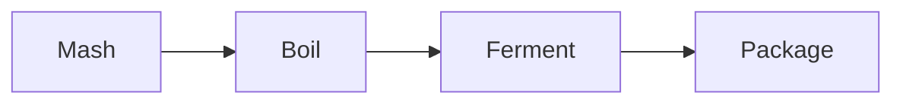

# Getting Started
This page explains how to add and edit content on the Mashers Wiki, which runs on [Wiki.js](https://js.wiki). It covers:

1. [How Wiki.js works](#how-wikijs-works)
2. [Creating and editing pages](#creating-and-editing-pages)
3. [Markdown basics](#markdown-basics)
4. [Wiki.js extras](#wikijs-extras)
5. [Structuring pages so they are easy to navigate](#structuring-pages-so-they-are-easy-to-navigate)
6. [Page checklist](#page-checklist)

---

## How Wiki.js Works

| Concept | Meaning |
|---|---|
| **Page** | A single document, written in markdown |
| **Path** | The page's address, such as `beer/techniques/mashing`. The path creates the page tree |
| **Tree** | The folder-like hierarchy built from paths. Visible in the left-hand navigation |
| **Tags** | Labels that group pages across the tree, such as `hops` or `beginner` |
| **Page history** | Every save is kept. You can view differences and restore older versions |
| **Git storage** | Pages are synchronised to a Git repository, which backs up the wiki and holds each page as a `.md` file |

> Pages are stored as plain markdown files in Git. You can edit them in Wiki.js, or locally in any text editor, and the changes will sync.
{.is-info}

---

## Creating and Editing Pages

### Create a New Page
1. Log in, then click **New Page** in the top-right (the page icon with a plus).
2. Choose the **location** (path). For example `beer/techniques/hopping/dry-hops`. Each `/` is a level in the tree.
3. Choose **Markdown** as the editor.
4. Fill in the **properties** (see below) and click **Close**.
5. Write the content, then click **Create**.

### Edit an Existing Page
1. Open the page and click the **pencil icon** (Edit page).
2. Make changes. Use the live preview on the right.
3. Click **Save**.

### Page Properties
Every page has these properties, set at the top of the editor (the page icon labelled *Page Properties*):

| Property | Rule |
|---|---|
| **Title** | Short, specific, Title Case. Shown at the top of the page and in navigation |
| **Short description** | One sentence summary. Shown in search results |
| **Tags** | 2 - 5 lower-case words, e.g. `beer, hops, ingredients` |
| **Published** | Leave on for pages that should be visible |

Internally these are stored as front matter at the top of each file:

```yaml
---
title: Dry Hops
description: Adding hops after fermentation begins for aroma
published: true
tags: beer, techniques, hops
editor: markdown
---
```

### Naming Paths
- Use **lower-case** words separated by hyphens: `single-infusion`, not `Single Infusion`.
- Keep names short and descriptive.
- Do not use spaces or special characters.
- Do not rename or move pages lightly. Links to the old path will break.

---

## Markdown Basics
Markdown is plain text with a few symbols that format it. The editor toolbar can insert most of these for you.

### Headings
```markdown
# Heading 1 (page title - use once per page)
## Heading 2 (main sections)
### Heading 3 (sub-sections)
```

### Text Formatting
| You type | You get |
|---|---|
| `**bold**` | **bold** |
| `*italic*` | *italic* |
| `~~strikethrough~~` | ~~strikethrough~~ |
| `` `inline code` `` | `inline code` |

### Lists
```markdown
- Bullet item
- Another item
  - Nested item (indent two spaces)

1. First step
2. Second step

- [ ] Task not done
- [x] Task done
```

### Links
```markdown
[Link to another wiki page](/beer/ingredients/hops)
[Link to a heading on a page](/beer/ingredients/hops#storage)
[External link](https://js.wiki)
```

- For **internal** links, start the address with `/` and use the page path.
- Do not include `.md` or the full website address.

### Images
```markdown

```
Upload images through the editor's **Insert Assets** button. Always add alt text, and check the [contribution policy](/admin) for image rules before using any image you didn't create.

### Quotes
```markdown
> This is a quote or note.
```

### Tables
```markdown
| Hop | Alpha acid | Use |
|---|---|---|
| Cascade | 5 - 7% | Aroma |
| Magnum | 12 - 14% | Bittering |
```

### Code Blocks
````markdown
```text
Anything that should be shown exactly as typed
```
````

### Horizontal Rule
```markdown
---
```

---

## Wiki.js Extras

### Callout Boxes
Add a class on the line after a blockquote to turn it into a coloured box:

```markdown
> Remember to sanitise your fermenter.
{.is-info}
```

| Class | Use for |
|---|---|
| `{.is-info}` | Helpful notes and definitions |
| `{.is-success}` | Tips and good practice |
| `{.is-warning}` | Cautions |
| `{.is-danger}` | Safety issues |

### Links List
Add `{.links-list}` after a bulleted list of links to display them as a neat list of cards. This is used on section index pages.

```markdown
 - [Hops](/beer/ingredients/hops)
 - [Yeast](/beer/ingredients/yeast)

 {.links-list}
```

### Table of Contents
Wiki.js builds a table of contents from your headings and shows it on the right of the page. Good headings give a good table of contents.

### Diagrams
Flowcharts can be written in text using Mermaid:

````markdown

````

---

## Structuring Pages so They Are Easy to Navigate

### 1. Use a Tree That Narrows Down
Content should go from general to specific. Each level is a page, and each page links down to its children.

```text
Home
└── Beer
    └── Techniques
        └── Mashing
            └── Decoction
```

The path for the last page is `beer/techniques/mashing/decoction`.

### 2. Give Every Section an Index Page
A parent page, such as `beer/techniques`, should briefly introduce the section and list its children. The pattern used in this wiki:

```markdown
# Techniques
One or two sentences describing the section.

| Page | Summary |
|---|---|
| [Mashing](/beer/techniques/mashing) | Converting grain starch to sugar |
| [Hopping](/beer/techniques/hopping) | Adding hops for bitterness and aroma |

Back to [Beer](/beer).
```

Or use a `{.links-list}` for short sections.

### 3. Link Up, Down and Across
- **Down:** the parent lists its children.
- **Up:** each child ends with "Back to [Parent](/path)".
- **Across:** link related pages in the text, e.g. link *Dry Hops* from *Hops*.

### 4. Standard Page Layout
Keep pages consistent so readers know where to find things:

```markdown
# Page Title
Short introduction: what this is and why it matters (2 - 3 sentences).

## Main Section
Content. Use tables for comparisons and lists for steps.

## Another Section

## Related
- [Related page](/path/to/page)

Back to [Parent Page](/path/to/parent).
```

### 5. Writing Guidelines
- **One topic per page.** Split pages that get long, and link between them.
- **Lead with the answer.** Put the most useful information first.
- **Use headings** every few paragraphs so readers can scan.
- **Prefer tables and lists** to long paragraphs.
- **Include units in both metric and imperial** (e.g. 19 L / 5 gal, 20 C / 68 F).
- **Name sources** where information has come from elsewhere.
- **Use plain language.** Explain jargon the first time you use it, or link to it.

### 6. Tags
Tags cut across the tree. Use a small, consistent set: the main area (`beer`), the section (`ingredients`), and the topic (`hops`). Check existing tags before inventing new ones.

---

## Page Checklist
Before you click **Save**, check:

- [ ] Title and description are filled in
- [ ] Path is lower-case with hyphens, and sits in the right place in the tree
- [ ] Tags added
- [ ] Single `#` title, with `##` sections below
- [ ] Linked **down** to children (if any) and **up** to the parent
- [ ] Linked to related pages
- [ ] Links open the right pages
- [ ] Images have alt text and permission to use
- [ ] Both metric and imperial measurements given
- [ ] Spelling checked

Back to [Admin](/admin).
